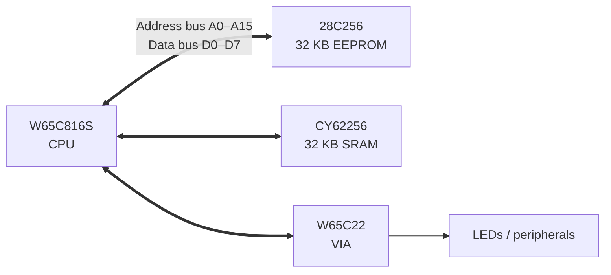

# W65C816S Computer

**A homebrew 8/16-bit computer built around the W65C816S processor, along with the custom PCBs and tools needed to program and debug it.**

**EEPROM Programmer:**


**Debug Board:**


This project is about understanding a computer from the transistor-level chips up: no operating system, no microcontroller doing the work behind the scenes, just a CPU, memory, and I/O wired together on a shared bus and running machine code I write and flash myself.

Along the way, I've designed two printed circuit boards in KiCad, written firmware and Python tools to program the system's ROM, and rebuilt the EEPROM programmer three times on three different platforms as I ran into hardware limits.

---

## Why the W65C816S?

The repo is named after the 6502, the processor inside the Apple II, Commodore 64, and NES. The computer actually uses the **W65C816S**, a modern descendant of the 6502 (and the CPU family used in the Super Nintendo and Apple IIGS).

The 65C816 boots in a 6502 **emulation mode**, so it runs ordinary 6502 code, but it can switch into a **native mode** with 16-bit registers and a 24-bit address space (16 MB instead of 64 KB). That gives the project room to grow beyond a classic 6502 build later on.

---

## System design

The computer is made of four main chips connected over a shared address and data bus:

| Chip | Part | Role |
|------|------|------|
| CPU | WDC W65C816S | 8/16-bit processor |
| ROM | 28C256 | 32 KB EEPROM that holds the program |
| RAM | CY62256 | 32 KB static RAM |
| I/O | WDC W65C22 | Versatile Interface Adapter (VIA): parallel I/O ports and timers |



### Memory map (so far)

| Address range | Device |
|---------------|--------|
| `$6000` – `$600F` | W65C22 VIA registers (`$6000` = Port B, `$6002` = Port B direction) |
| `$8000` – `$FFFF` | 28C256 ROM |
| `$FFFC` – `$FFFD` | Reset vector (where the CPU starts executing) |

---

## Hardware

### 1. CPU debug board

**Files:** `6502 Computer.kicad_sch`, `6502 Computer.kicad_pcb`, `production/`

A PCB that holds the W65C816S in a 40-pin socket and breaks out every useful signal to labeled pin headers so the CPU can be probed and monitored:

- **16-pin header:** address bus A0–A15
- **8-pin header:** data bus D0–D7
- **Control headers:** CLK, R/W, E, MX, VDA, VPA, VP, and ML
- **Power header:** 5V and GND
- **Reset circuit:** push button with a 10 kΩ pull-up and 1 µF capacitor, so the CPU gets a clean reset pulse
- **Pull-up resistors (3.3 kΩ)** on the RDY, IRQ, and NMI inputs, so the CPU doesn't halt or take spurious interrupts while those lines are unused

All the signal names are printed on the silkscreen next to each pin.

### 2. Arduino Mega bus monitor

**Files:** `W65C816S_monitor/W65C816S_monitor.ino`

The debug board is paired with an Arduino Mega that acts as both the **clock** and a **logic analyzer**. The Mega drives the CPU's clock pin itself at a very slow speed (about 50 Hz) and, on every clock cycle, reads all 16 address lines, all 8 data lines, and the R/W line, then prints them over serial. Example output:

```
1111111111111100  00000000   fffc  r  00
1111111111111101  00000000   fffd  r  80
1000000000000000  10101001   8000  r  a9
```

This makes it possible to watch the CPU fetch its reset vector and step through a program one bus cycle at a time, which is how I verify the hardware is wired correctly before running it at full speed.

### 3. EEPROM programmer

**Files:** `EEPROM_Programmer/`

The ROM chip has to be loaded with a program before the computer can run, so I built a dedicated programmer for the 28C256. It went through three versions:

| Version | Platform | Outcome |
|---------|----------|---------|
| 1 | Arduino Uno | Worked, but the Uno doesn't have enough GPIO pins, so only 128 bytes of the 32 KB chip were reachable |
| 2 | Raspberry Pi (`file_uploader.py`) | Full 32 KB address range driven directly from the Pi's GPIO pins; can flash complete ROM images |
| 3 | Arduino Mega shield (PCB) | A custom shield that plugs onto a Mega and holds the EEPROM in a socket, wiring all 15 address lines, 8 data lines, and the control lines straight to the Mega's pins |

The Raspberry Pi tool (`file_uploader.py`) has two modes:

- **ROM flashing:** `python3 file_uploader.py rom.bin` writes a full binary to the chip, verifies every byte by reading it back, and automatically retries any addresses that failed.
- **Interactive monitor:** a small BIOS-style prompt for working with the chip by hand:

```
Enter command (clear/write/read <address> <data>/exit): write 0000 a9
Writing 0xA9 to address 0x00
Enter command (clear/write/read <address> <data>/exit): read 0000
Read 0xA9 from address 0x0000
```

Each write uses **data polling**: after writing a byte, the programmer keeps reading that address until the chip returns the correct value, since the EEPROM needs a few milliseconds to finish storing each byte internally.

---

## Software

### Writing programs

Programs are written in 6502 assembly. For example, `EEPROM_Programmer/blink.s` sets the VIA's Port B to output and writes a pattern to it to light LEDs (slightly simplified):

```asm
    .org $8000

reset:
    lda #$ff
    sta $6002     ; set all Port B pins to output

loop:
    lda #$aa
    sta $6000     ; write 10101010 to Port B
    jmp loop

    .org $fffc
    .word reset   ; reset vector points to the start of the program
    .word $0000
```

### Build and flash

1. Assemble the program into a 32 KB binary (for example with [vasm](http://sun.hasenbraten.de/vasm/)):
   ```bash
   vasm6502_oldstyle -Fbin -dotdir blink.s -o rom.bin
   ```
2. Copy `rom.bin` to the Raspberry Pi and flash it:
   ```bash
   python3 file_uploader.py rom.bin
   ```
3. Move the EEPROM into the computer and press reset.

`makerom.py` generates a test ROM filled entirely with `$EA` (the 6502 `NOP` instruction). This is useful for a first power-on, since the CPU just walks through memory and the address bus counts upward on the monitor.

`serial_monitor.py` is a small two-way serial terminal for talking to the Arduino-based tools from a computer.

---

## Repository layout

```
6502-Computer/
├── 6502 Computer.kicad_*        # CPU debug board (schematic + PCB)
├── 6502_computer.kicad_sch      # Full system schematic: CPU, ROM, RAM, VIA
├── clock.kicad_sch              # Clock module (not started)
├── production/                  # Gerbers, BOM, and placement files for the debug board
├── W65C816S_monitor/            # Arduino Mega bus monitor / clock
├── EEPROM_Programmer/
│   ├── EEPROM_Programmer.kicad_*    # Arduino Mega programmer shield
│   ├── production/                  # Manufacturing files for the shield
│   ├── EEPROM_Programmer.ino        # Mega firmware (in progress)
│   ├── file_uploader.py             # Raspberry Pi programmer and ROM flasher
│   ├── makerom.py                   # Generates a NOP-filled test ROM
│   ├── serial_monitor.py            # Serial terminal
│   └── blink.s, test.s              # Example assembly programs
└── Assembly Code/
```

---

## Project status

| Part | Status |
|------|--------|
| CPU debug board | PCB designed and sent for manufacturing |
| Bus monitor firmware | Working |
| EEPROM programmer (Raspberry Pi) | Working: reads, writes, clears, and flashes full ROM images |
| EEPROM programmer shield (Arduino Mega) | PCB designed and sent for manufacturing; firmware being ported from the Pi version |
| Full system schematic (CPU + ROM + RAM + VIA) | Schematic drawn; address decoding and PCB layout still to do |
| Clock module | Planned |

## Roadmap

- [ ] Finish the Arduino Mega programmer firmware
- [ ] Assemble and test both PCBs when they arrive
- [ ] Finalize address decoding and lay out the full computer PCB
- [ ] Add a dedicated clock module (adjustable speed plus single-step)
- [ ] Add an LCD display and a serial port for input/output
- [ ] Latch the bank address byte to use the 65C816's full 24-bit address space

---

## Tools

KiCad · Arduino (C++) · Python · Raspberry Pi GPIO · 6502 assembly

## Acknowledgments
 
This project was inspired by Ben Eater's [**"Build a 6502 computer"**](https://eater.net/6502) video series, which is where I learned how microprocessors work: how a CPU fetches instructions, how it talks to memory and I/O over the address and data buses, and how a computer starts up from its reset vector.
 
The hardware in this repo is my own work. I chose to build around the W65C816S instead of the 6502, and I did all the wiring and designed both PCBs (the CPU debug board and the Arduino Mega EEPROM programmer shield) myself, along with the Raspberry Pi EEPROM programmer.
 
The Arduino bus monitor sketch and the example assembly programs are based on the ones shown in the series.
